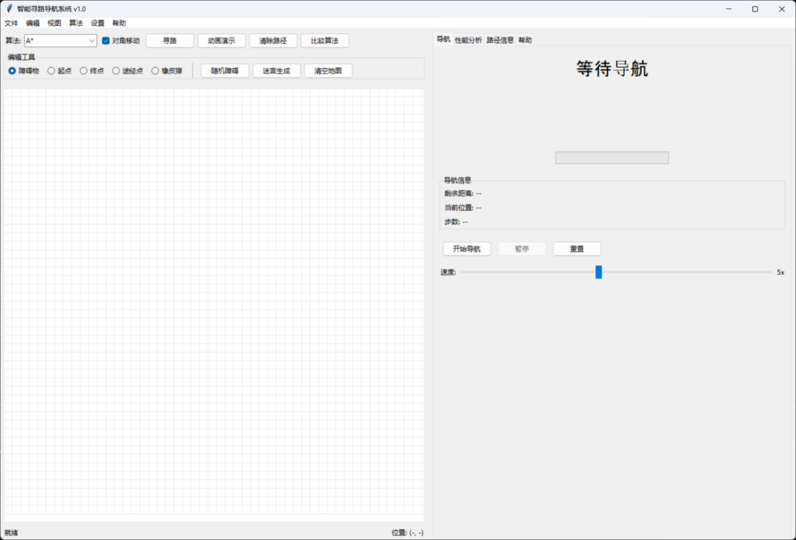
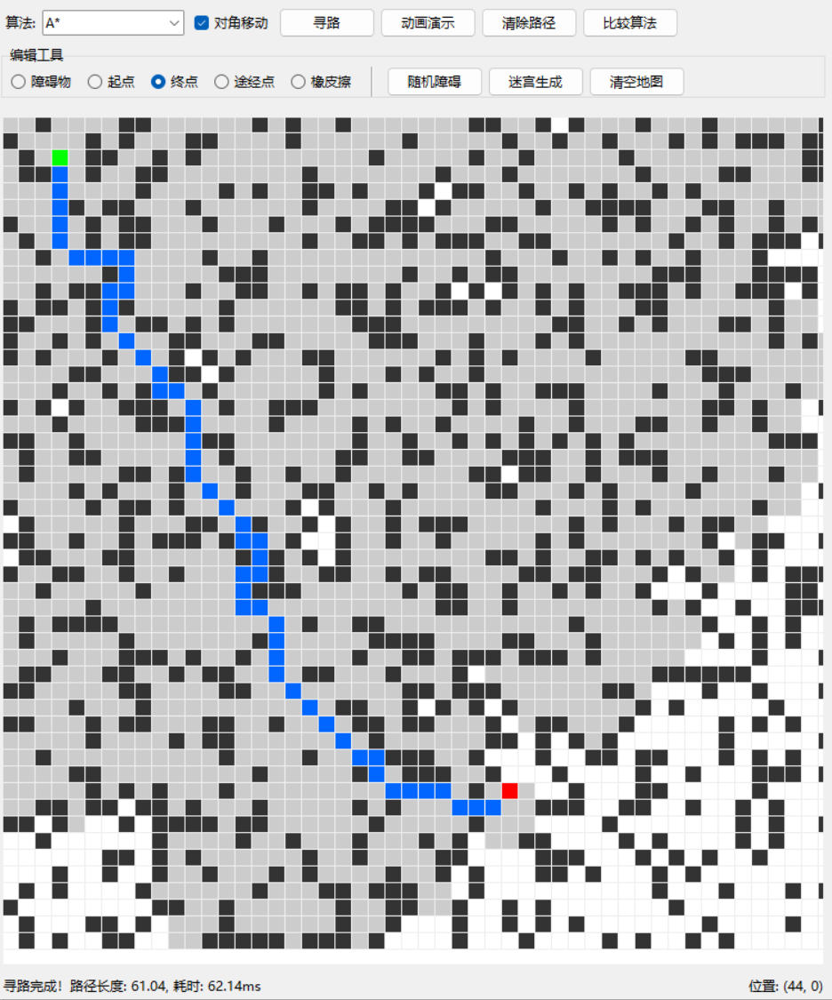
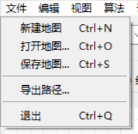
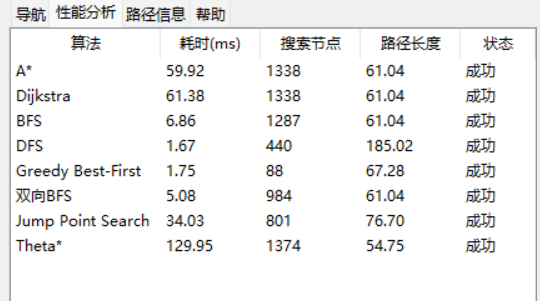

# 智能寻路导航系统 · Smart Navigation

> 八种经典寻路算法的交互式可视化平台：画地图、跑算法、看动画、比性能。


一个用纯 Python 标准库（Tkinter）写成的寻路算法实验台。左边是地图编辑器，右边是导航面板和性能分析面板：你可以手绘障碍物、拖出迷宫、设置起点终点和途经点，然后用八种算法求解、看搜索动画、比较各自的耗时与搜索节点数。

适合用来**学习算法原理**、**给算法课做演示**，或者作为**机器人 / 游戏 AI 路径规划的算法原型**。



---

## 目录

- [功能特性](#功能特性)
- [快速开始](#快速开始)
- [界面导览](#界面导览)
- [八种算法](#八种算法)
- [性能实测](#性能实测)
- [快捷键](#快捷键)
- [地图文件格式](#地图文件格式)
- [作为 Python 库使用](#作为-python-库使用)
- [项目结构](#项目结构)
- [开发与测试](#开发与测试)
- [已知限制](#已知限制)
- [English Summary](#english-summary)
- [许可证](#许可证)

---

## 功能特性

| 功能 | 说明 |
| --- | --- |
| **地图编辑器** | 鼠标点击/拖拽绘制障碍物，设置起点（绿）、终点（红）、途经点（橙），橡皮擦与右键删除 |
| **八种算法** | A\*、Dijkstra、BFS、DFS、贪心最佳优先、双向 BFS、Jump Point Search、Theta\* |
| **路径可视化** | 搜索过的节点用浅灰铺开，最终路径用蓝色高亮，支持任意时刻中断 |
| **动画演示** | 逐帧回放搜索过程，速度可调，直观看出各算法的"扩张形状"差异 |
| **算法对比** | 一键跑完八种算法，表格列出耗时、搜索节点数、路径长度 |
| **导航模拟** | 沿路径模拟行进：方向指示（↑↗→↘↓↙←↖）、进度条、剩余距离、当前步数，速度可调 |
| **多途经点规划** | 必须经过若干中间点，用最近邻 + 2-opt 求解旅行商顺序后拼接路径 |
| **地图管理** | JSON 保存/加载、随机障碍、完美迷宫生成、房间/走廊模板、ASCII 与 CSV 互转 |
| **路径后处理** | 视线拉直（路径平滑）、捷径优化、线性/贝塞尔插值 |
| **性能分析** | 内置基准测试与统计汇总，可导出 CSV |

## 快速开始

### 环境要求

- Python **3.8+**
- Tkinter（Windows / macOS 官方 Python 自带；Ubuntu 需 `sudo apt install python3-tk`）
- **无需安装任何第三方包**

### 运行

```bash
git clone https://github.com/qike9/smart-navigation.git
cd smart-navigation
python smart_navigation.py
```

等价写法：

```bash
python -m smartnav
```

可选：安装成命令

```bash
pip install -e .
smart-navigation
```

### 上手三步

1. 点击工具栏「随机障碍」或「迷宫生成」造一张地图；
2. 左侧编辑工具切到「起点」「终点」，在地图上点两个位置；
3. 选好算法，点「寻路」→ 蓝色路径出现；点「动画演示」看搜索过程；点「比较算法」看性能对比。



## 界面导览

| 位置 | 内容 |
| --- | --- |
| 菜单栏 | 文件（新建/打开/保存/导出路径）、编辑（清空/随机障碍/生成迷宫）、视图（网格/坐标/缩放）、算法（八种算法 + 比较全部）、设置、帮助 |
| 工具栏 | 算法下拉框、对角移动开关、寻路、动画演示、清除路径、比较算法 |
| 编辑工具栏 | 障碍物、起点、终点、途经点、橡皮擦；随机障碍、迷宫生成、清空地图 |
| 右侧面板 | 导航模拟（开始/暂停/重置、速度滑块）与性能分析（各算法指标表格） |
| 状态栏 | 当前编辑模式、鼠标所在格坐标、操作结果提示 |

<table>
<tr>
<td></td>
<td></td>
</tr>
<tr>
<td align="center">编辑工具栏</td>
<td align="center">算法性能对比</td>
</tr>
</table>

更多界面截图见 [`docs/images`](docs/images)，完整操作说明见 [`docs/用户手册.md`](docs/用户手册.md)。

## 八种算法

| 算法 | 是否保证最短 | 特点 | 典型场景 |
| --- | --- | --- | --- |
| **A\*** | ✅ 加权最短 | 启发式 + 代价，综合最优 | 默认首选 |
| **Dijkstra** | ✅ 加权最短 | 无启发，向四周均匀扩散 | 单源最短路、对照基准 |
| **BFS** | ✅ 步数最少 | 分层推进，不看权重 | 无权图、最少转弯 |
| **DFS** | ❌ | 一条道走到黑，路径冗长 | 迷宫求解、快速找任一路径 |
| **贪心最佳优先** | ❌ | 只看"离终点多远"，极快 | 实时性优先、可接受次优解 |
| **双向 BFS** | ✅ 步数最少 | 两端同时扩张，节点数近乎开方 | 大地图、单次查询 |
| **Jump Point Search** | ✅ 加权最短 | 跳过对称路径，只在跳点决策 | 开阔地形，节点数可降两个数量级 |
| **Theta\*** | ✅（任意角度） | 视线检测拉直路径，不受网格约束 | 需要自然轨迹的移动体 |

各算法原理与伪代码见 [`docs/算法说明.md`](docs/算法说明.md)。

## 性能实测

> 数据由 `python tools/benchmark.py` 生成，同一台机器上相对比较才有意义。

**开阔地形**（61×61 无障碍，允许斜走）：

| 算法 | 搜索节点 | 平均耗时 | 路径长度 |
| --- | ---: | ---: | ---: |
| Jump Point Search | **10** | **4.4 ms** | 82.02 |
| 贪心最佳优先 | 59 | 2.9 ms | 82.02 |
| 双向 BFS | 1922 | 11.2 ms | 82.02 |
| BFS | 3600 | 22.6 ms | 82.02 |
| DFS | 3608 | 22.9 ms | 294.04 |
| A\* | 3714 | 400.6 ms | 82.02 |
| Dijkstra | 3714 | 395.2 ms | 82.02 |
| Theta\* | 3716 | 1528.7 ms | 82.02 |

开阔地图上 JPS 只用 **10 个节点**就锁定最优路径，比 A\* 少搜索 99.7% 的格子——这正是跳点搜索的价值。

**稠密地形**（51×51 随机障碍 28%）：

| 算法 | 搜索节点 | 平均耗时 | 路径长度 |
| --- | ---: | ---: | ---: |
| 贪心最佳优先 | **84** | **1.8 ms** | 85.11 |
| DFS | 1311 | 6.3 ms | 244.91 |
| 双向 BFS | 1307 | 6.1 ms | 86.18 |
| BFS | 1832 | 9.5 ms | 84.53 |
| A\* | 1833 | 97.8 ms | 83.70 |
| Dijkstra | 1833 | 97.0 ms | 83.70 |
| Jump Point Search | 1838 | 97.2 ms | 83.70 |
| Theta\* | 1827 | 200.7 ms | **72.64** |

此时障碍物把空间切得很碎，JPS 的跳点剪枝收益消失，会自动回退到 A\*（见[已知限制](#已知限制)）；而 Theta\* 靠视线拉直把路径从 83.7 缩短到 **72.6**，代价是更多的视线检测开销。

自己复现：

```bash
python tools/benchmark.py                          # 默认 51×51 / 28% 障碍
python tools/benchmark.py --size 81 --density 0.2  # 换个尺寸和密度
python tools/benchmark.py --maze --size 41         # 换成完美迷宫
python tools/benchmark.py --no-diagonal            # 只允许上下左右
python tools/benchmark.py --map-file examples/maps/maze-41x41.json
```

## 快捷键

| 快捷键 | 功能 |
| --- | --- |
| `Ctrl+N` | 新建地图 |
| `Ctrl+O` | 打开地图 |
| `Ctrl+S` | 保存地图 |
| `Ctrl+E` | 导出路径 |
| `Ctrl+Z` / `Ctrl+Y` | 撤销 / 重做（新建、清空、随机障碍、迷宫生成、打开地图） |
| `Ctrl+G` | 显示/隐藏网格 |
| `Ctrl+Shift+G` | 显示/隐藏坐标刻度 |
| `Ctrl+=` / `Ctrl+-` | 放大 / 缩小 |
| `F5` | 寻路 |
| `F6` | 动画演示 |
| `F7` | 清除路径 |
| `F1` | 帮助 |
| `Esc` | 停止动画 |
| `Ctrl+Q` | 退出 |

## 地图文件格式

地图以 JSON 保存，尺寸、障碍物、起终点、途经点全都可读可改：

```json
{
  "width": 12,
  "height": 12,
  "obstacles": [[3, 3], [3, 4], [3, 5]],
  "start": [1, 1],
  "end": [10, 10],
  "waypoints": [[5, 8]]
}
```

也支持纯文本 ASCII 地图（`.` 空地、`#` 障碍、`S` 起点、`E` 终点、`W` 途经点），便于在代码或测试里手写关卡：

```python
from smartnav.maps import MapConverter

grid = MapConverter.from_ascii(open("examples/maps/level-ascii.txt", encoding="utf-8").read())
```

示例地图在 [`examples/maps/`](examples/maps)：
`maze-41x41.json`（完美迷宫）、`rooms-40x30.json`（房间）、`random-51x51.json`（随机障碍）、`corridor-60x31.json`（走廊）、`level-ascii.txt`（ASCII 关卡）。

## 作为 Python 库使用

GUI 之外，算法层完全可以单独调用——无 Tkinter 依赖，可直接放进服务端或脚本：

```python
from smartnav import AlgorithmFactory, GridMap, Position

grid = GridMap(50, 50)
grid.set_start(Position(2, 2))
grid.set_end(Position(47, 47))
grid.generate_maze()

algo = AlgorithmFactory.create_algorithm("A*", grid, allow_diagonal=True)
result = algo.find_path(grid.start_position, grid.end_position)

print(result.success, result.path_length, result.nodes_explored)
print([(p.x, p.y) for p in result.path][:5])
```

多途经点 + 路径平滑：

```python
from smartnav.planning import MultiWaypointPlanner, PathSmoother

planner = MultiWaypointPlanner(grid, "A*", allow_diagonal=True)
result = planner.plan(
    start=Position(1, 1),
    waypoints=[Position(10, 30), Position(40, 5)],
    end=Position(48, 48),
)
smoothed = PathSmoother.smooth_path(result.path, grid)  # 视线拉直，节点数大幅减少
```

导航模拟：

```python
from smartnav.navigation import NavigationSimulator

sim = NavigationSimulator(result.path, grid)
while not sim.is_finished():
    print(sim.get_current_position(), sim.get_direction(), f"{sim.get_progress():.0f}%")
    sim.advance()
```

## 项目结构

```
smart_navigation/
├── smart_navigation.py        # 图形界面入口
├── smartnav/
│   ├── models.py              # 坐标 / 方向 / 地图 / 路径结果
│   ├── algorithms.py          # 八种寻路算法 + 算法工厂
│   ├── planning.py            # 多途经点 TSP、路径平滑/优化/插值
│   ├── navigation.py          # 导航模拟、多智能体仿真、路径录制
│   ├── analysis.py            # 性能分析、指标计算、可达性检查、热力图
│   ├── maps.py                # 地图读写、模板生成、ASCII/CSV 转换、导出
│   ├── utils.py               # 撤销重做、坐标变换
│   └── ui/                    # Tkinter 界面（画布 / 面板 / 对话框 / 主窗口）
├── tests/                     # 174 个 pytest 用例（全部无界面，可进 CI）
├── tools/benchmark.py         # 命令行基准测试
├── examples/maps/             # 示例地图
├── docs/                      # 用户手册、算法说明、截图
└── legacy/                    # 早期"城市路网导航"版本（仅归档，不参与主程序）
```

## 开发与测试

```bash
pip install -r requirements-dev.txt

python -m pytest tests/ -q          # 跑全部单元测试
python -m pytest tests/ -k jps -v   # 只跑 JPS 相关
python tools/benchmark.py           # 算法性能对比
ruff check .                        # 代码检查
```

测试覆盖了算法最优性（A\*/Dijkstra/BFS/JPS 代价一致性）、随机地图一致性、路径合法性、地图 JSON/ASCII/CSV 往返、多途经点顺序、平滑后路径不穿墙、导航模拟进度等。

## 已知限制

- **JPS 在稠密地图上会回退 A\***：本项目全局采用"禁止穿墙角"的八向移动规则，而标准 JPS 的剪枝前提是允许穿角。当地图出现 1 格宽缝隙（迷宫、随机障碍）时跳点搜索可能漏掉唯一通路，此时程序自动改用 A\* 求解，并在结果消息里标注——**路径始终最优，只是性能等同于 A\***。开阔地形下 JPS 的剪枝优势仍然完整保留。
- **Theta\* 的代价较高**：每次扩展都要做视线检测，节点数多时明显慢于 A\*，但换来的路径更短更自然。
- **BFS 系列优化的是步数**，允许斜走（代价 1.414）时路径长度可能略大于 A\*。
- 地图尺寸建议不超过 500×500（再大渲染会明显卡顿，`MapValidator` 也会给出警告）。
- 界面基于 Tkinter，不支持高 DPI 自动缩放以外的复杂渲染。

## English Summary

**Smart Navigation** is an interactive pathfinding playground written in pure Python (stdlib only, Tkinter GUI). It ships a grid map editor, eight classic search algorithms — A\*, Dijkstra, BFS, DFS, Greedy Best-First, Bidirectional BFS, Jump Point Search and Theta\* — plus search animation, side-by-side benchmarking, multi-waypoint (TSP) planning, path smoothing and a navigation simulator.

```bash
python smart_navigation.py       # launch the GUI
python tools/benchmark.py        # headless algorithm benchmark
python -m pytest tests/ -q       # 174 unit tests
```

The algorithm layer has no GUI dependency and can be imported directly:

```python
from smartnav import AlgorithmFactory, GridMap, Position

grid = GridMap(50, 50)
grid.set_start(Position(2, 2)); grid.set_end(Position(47, 47))
result = AlgorithmFactory.create_algorithm("A*", grid).find_path(grid.start_position, grid.end_position)
```

Licensed under MIT.

## 许可证

[MIT](LICENSE) © 2026 qike9
