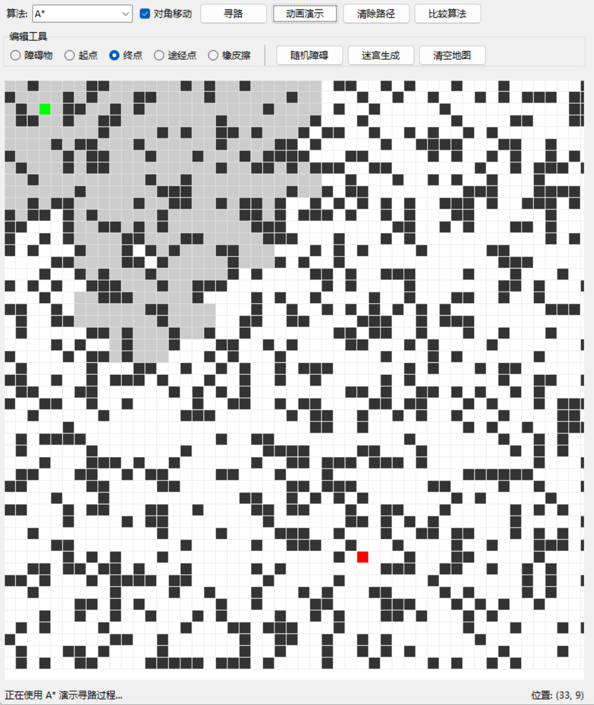
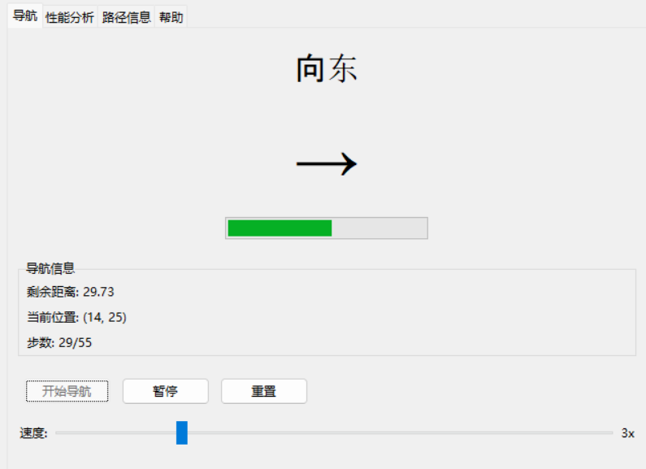

# 智能寻路导航系统 · 用户手册

> Version 1.0 · 适用于本仓库当前版本

## 目录

- [一、系统概述](#一系统概述)
- [二、运行环境](#二运行环境)
- [三、安装与启动](#三安装与启动)
- [四、界面介绍](#四界面介绍)
- [五、操作说明](#五操作说明)
- [六、快捷键](#六快捷键)
- [七、地图文件](#七地图文件)
- [八、常见问题](#八常见问题)

---

## 一、系统概述

智能寻路导航系统是一款专业的路径规划与导航软件，支持多种经典寻路算法，提供直观的路径可视化与实时导航模拟。适用于机器人路径规划、游戏开发、智能运输系统等领域：快速构建地图环境、设置起点终点和障碍物，再用不同算法计算并比较最优路径。

### 1.1 主要功能

- **地图编辑器**：创建、编辑地图，设置障碍物、起点、终点与途经点
- **八种寻路算法**：A\*、Dijkstra、BFS、DFS、Greedy Best-First、双向 BFS、Jump Point Search、Theta\*
- **路径可视化**：实时展示搜索节点与最终路径
- **导航模拟**：模拟行进过程，显示方向指示、进度与剩余距离
- **地图管理**：JSON 保存/加载，随机障碍、迷宫、房间、走廊模板
- **性能分析**：比较各算法耗时、搜索节点数、路径长度
- **多途经点规划**：求解 TSP 顺序的多点路径优化

### 1.2 系统特点

- **界面友好**：分栏式布局，左编辑右分析，操作直观
- **算法丰富**：八种算法覆盖最优解、近似解、任意角度三类思路
- **可视化强**：动画回放搜索过程，直观理解算法差异
- **零依赖**：纯标准库实现，克隆即跑；算法层可脱离界面单独调用
- **可测试**：174 个单元测试，算法正确性有断言保障

## 二、运行环境

### 2.1 硬件要求

| 项目 | 最低配置 | 建议配置 |
| --- | --- | --- |
| CPU | 双核 1.6 GHz | 四核 2.4 GHz 及以上 |
| 内存 | 2 GB | 8 GB |
| 显示分辨率 | 1280×720 | 1920×1080 |
| 磁盘 | 50 MB 可用空间 | 200 MB |

### 2.2 软件要求

| 项目 | 要求 |
| --- | --- |
| 操作系统 | Windows 10+ / macOS 10.14+ / 主流 Linux 发行版 |
| Python | 3.8 及以上 |
| 图形库 | Tkinter（官方安装包自带；Ubuntu 需 `sudo apt install python3-tk`） |
| 第三方包 | 无 |

## 三、安装与启动

### 3.1 安装步骤

1. 确认已安装 Python 3.8 或更高版本：

   ```bash
   python --version
   ```

2. 获取代码：

   ```bash
   git clone https://github.com/qike9/smart-navigation.git
   cd smart-navigation
   ```

   也可直接下载仓库压缩包解压。

3. （可选）安装为命令：

   ```bash
   pip install -e .
   ```

### 3.2 启动程序

```bash
python smart_navigation.py
```

以下写法等价：

```bash
python -m smartnav
smart-navigation        # 执行过 pip install -e . 之后
```

启动后出现主界面窗口，包含地图编辑区、控制面板、导航面板与性能分析面板。

> 无图形界面的服务器上无法启动 GUI，但算法层可以直接用 Python 调用，见 README 的「作为 Python 库使用」。

## 四、界面介绍

### 4.1 主界面布局

左侧为地图编辑区，右侧为功能面板区。上方工具栏包含算法选择与寻路操作按钮；中间为编辑工具栏，提供各种编辑模式；下方状态栏显示当前操作状态与光标位置。


### 4.2 菜单栏

**文件菜单**

| 菜单项 | 说明 |
| --- | --- |
| 新建地图 | 清空当前地图，创建空白地图（可撤销） |
| 打开地图 | 从 JSON 文件加载地图 |
| 保存地图 | 将当前地图保存为 JSON |
| 导出路径 | 将路径导出为文本或 JSON |
| 退出 | 关闭程序 |

**编辑菜单**

| 菜单项 | 说明 |
| --- | --- |
| 清空地图 | 清除所有障碍物与特殊点位（可撤销） |
| 清除路径 | 只清除路径与搜索痕迹 |
| 随机障碍物 | 按密度随机撒障碍（可撤销） |
| 生成迷宫 | 生成完美迷宫（可撤销） |

**视图菜单**：显示网格、显示坐标、缩放。

**算法菜单**：列出八种算法，点击直接运行；「比较所有算法」一次性跑完全部并填入性能表。

### 4.3 工具栏


- **算法下拉框**：选择本次使用的算法
- **对角移动**：是否允许斜向移动（关闭后只能上下左右）
- **寻路**：用当前算法计算路径
- **动画演示**：以动画回放搜索过程
- **清除路径**：清掉蓝色路径与灰色搜索痕迹
- **比较算法**：跑完八种算法并比较

### 4.4 编辑工具


| 模式 | 说明 |
| --- | --- |
| 障碍物 | 点击/拖动添加障碍物，再次点击可移除 |
| 起点 | 设置起点（绿色），全图仅一个 |
| 终点 | 设置终点（红色），全图仅一个 |
| 途经点 | 添加必须经过的中间点（橙色），可加多个 |
| 橡皮擦 | 删除障碍物与途经点 |

## 五、操作说明

### 5.1 地图编辑

1. 选择编辑模式（障碍物 / 起点 / 终点 / 途经点 / 橡皮擦）；
2. 在地图区域点击或拖动进行编辑；
3. 右键点击可直接删除障碍物或途经点；
4. 也可以直接用「随机障碍」「迷宫生成」快速铺一张图。

**设置起点和终点**：选「起点」模式点击地图（绿色），再选「终点」模式点击（红色）。每个地图只有一个起点和一个终点，设置新位置会自动替换旧位置。

**添加障碍物**：选「障碍物」模式点击或拖动（深灰）。再次点击已有障碍物可移除，也可右键或切到橡皮擦删除。


### 5.2 寻路操作

**基本寻路**

1. 确保起点与终点都已设置；
2. 在工具栏选择算法；
3. 按需勾选「对角移动」；
4. 点「寻路」，路径以蓝色显示。


**动画演示**

点「动画演示」，系统逐帧回放搜索过程：浅灰表示已搜索节点，蓝色表示最终路径。可以直观看出 A\* 的"锥形收缩"、BFS 的"同心圆扩散"、DFS 的"一条道走到黑"。



**算法比较**

点「比较算法」，八种算法依次执行，性能分析面板列出各自的耗时、搜索节点数与路径长度。


### 5.3 导航模拟

算出路后，右侧导航面板可以模拟行进：

1. 点「开始导航」开始；
2. 方向指示区显示当前朝向（↑↗→↘↓↙←↖）；
3. 进度条显示行程百分比；
4. 信息区显示剩余距离、当前位置、步数；
5. 「暂停」暂停、「重置」回到起点；
6. 拖动速度滑块调整模拟速度。



### 5.4 多途经点规划

在地图上添加若干个途经点后，通过「算法 → 多途经点规划」打开对话框，系统会：

1. 用当前算法计算所有关键点之间的实际路网距离，构成距离矩阵；
2. 用最近邻构造初始顺序，再用 2-opt 迭代优化；
3. 按优化后的顺序拼接各段路径。

得到一条**依次经过所有途经点**的完整路径。

## 六、快捷键

| 快捷键 | 功能 |
| --- | --- |
| `Ctrl+N` | 新建地图 |
| `Ctrl+O` | 打开地图 |
| `Ctrl+S` | 保存地图 |
| `Ctrl+E` | 导出路径 |
| `Ctrl+Z` / `Ctrl+Y` | 撤销 / 重做 |
| `Ctrl+G` | 显示/隐藏网格 |
| `Ctrl+Shift+G` | 显示/隐藏坐标 |
| `Ctrl+=` / `Ctrl+-` | 放大 / 缩小 |
| `F5` | 寻路 |
| `F6` | 动画演示 |
| `F7` | 清除路径 |
| `F1` | 帮助 |
| `Esc` | 停止动画 |
| `Ctrl+Q` | 退出 |

## 七、地图文件

地图保存为 JSON，位于 `~/SmartNavigation/maps`（可用环境变量 `SMARTNAV_MAPS_DIR` 改到别处）：

```json
{
  "width": 50,
  "height": 50,
  "obstacles": [[10, 10], [10, 11]],
  "start": [2, 2],
  "end": [47, 47],
  "waypoints": [[20, 20]]
}
```

手工修改该文件也是安全的：`obstacles` 越界的点会被忽略，起点终点重复时以最后出现的为准。

ASCII 文本格式（`.` 空地、`#` 障碍、`S` 起点、`E` 终点、`W` 途经点）适合手写小型关卡：

```
##########
#S...#...#
#.#.#.#..#
#.#...#..#
#...###..#
#........#
#......#E#
##########
```

## 八、常见问题

**1. 无法找到路径**

原因：起点与终点之间没有可通行路径，被障碍物完全阻隔（随机障碍地图很容易出现）。
处理：检查障碍物分布，删掉一部分创造通道；或用「算法 → 多途经点」前先确认可达性。「文件 → 导出路径」为空说明本次确实无解。

**2. 程序启动失败，提示 `No module named 'tkinter'`**

原因：Python 未安装 Tk 组件。
处理：Windows/macOS 请使用 python.org 官方安装包；Ubuntu/Debian 执行 `sudo apt install python3-tk`；部分精简版 Linux 发行版需要单独装 `tk`。

**3. 地图文件无法加载**

原因：文件不是本程序保存的 JSON，或已损坏。
处理：确认文件能被 `json.load` 解析，且包含 `width` / `height` 字段。实在无法恢复就重新画一张。

**4. 选了 JPS 但速度和 A\* 一样**

这是预期行为：在 1 格宽缝隙或高密度障碍地图上，跳点剪枝会失效，程序自动回退 A\* 并在状态栏/结果里提示。换到开阔地图（或把障碍密度降到 10% 以下）就能看到 JPS 用极少的节点数秒算。

**5. 比较算法时 Theta\* 明显更慢，是否正常**

正常。Theta\* 每次扩展都要做视线检测，代价更高，换来的是更短、更自然的任意角度路径。

**6. 撤销为什么没把某次鼠标涂的障碍撤掉**

撤销栈记录的是**批量操作**（新建、清空、随机障碍、迷宫生成、打开地图），鼠标逐格编辑不进入撤销栈，避免栈被大量单格操作挤爆。
